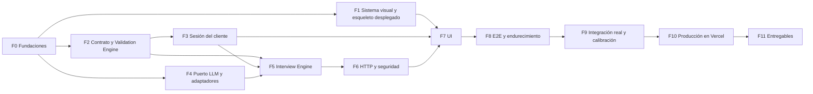

# Plan de implementación

> Orden estricto de implementación, dependencias entre fases y criterios de aceptación de cada fase. Las decisiones que justifican este plan están en [docs/adr](docs/adr/README.md); el diseño del sistema, en [docs/ARCHITECTURE.md](docs/ARCHITECTURE.md); el de la entrevista, en [DESIGN.md](DESIGN.md).

## Cómo se trabaja

- **Orden.** Las fases se implementan en el orden numérico. Algunas son independientes entre sí (F1, F2 y F4); se pueden adelantar, pero se integran en ese orden.
- **Ramas.** Una rama por fase (`fase/f2-validation-engine`) con su PR hacia `main`. Se integra con *Rebase and merge*, para que el historial conserve los commits pequeños que pide el enunciado.
- **Commits.** Convencionales y pequeños: un módulo o un comportamiento con sus tests. Por ejemplo, `feat(domain): add requirement coverage analysis`. Tipos: `feat`, `fix`, `test`, `refactor`, `chore`, `ci`, `docs`.
- **Definición de terminado** (para cada fase):
  - la CI está en verde;
  - se cumplen todos los criterios de aceptación de la fase;
  - no queda ningún `TODO` sin issue;
  - si la implementación contradice un ADR, el ADR se actualiza en el mismo PR.
- **👤** marca las tareas que necesitan una acción tuya: cuentas, keys o grabaciones.
- **Tamaño relativo:** S (horas), M (medio día a un día), L (más de un día).

## Dependencias

---

## F0 · Fundaciones del repositorio · S

**Objetivo:** que el repo tenga herramientas, reglas y CI funcionando antes de la primera línea de producto.
**Depende de:** nada.

| ID | Tarea |
|---|---|
| F0.1 | 👤 Crear el repositorio en GitHub. Ejecutar `git init` con la rama `main`. |
| F0.2 | Generar el proyecto Next.js (App Router, TypeScript, `src/`, Tailwind v4, ESLint) con pnpm. Fijar Node 24 en `.nvmrc` y en `engines`. |
| F0.3 | Configurar `tsconfig` con `strict` y `noUncheckedIndexedAccess`, y el alias `@/*`. |
| F0.4 | Configurar ESLint (flat config): límites de import de ARCHITECTURE §4.4, `openai` permitido solo en el adaptador y `react/no-danger`. Agregar Prettier. |
| F0.5 | Configurar Vitest con dos proyectos (`node` para `domain` y `server`, `jsdom` para `features`) y cobertura con v8. |
| F0.6 | Escribir `.gitignore` (excluye `.env*` salvo `.env.example`) y `.env.example` con todas las variables de ARCHITECTURE §11, sin valores. Instalar `server-only`. |
| F0.7 | CI en GitHub Actions: instalación con caché de pnpm, `typecheck`, `lint`, `test`, `build` y `gitleaks`. |
| F0.8 | Reemplazar `READM.md` por un `README.md` provisional y commitear la documentación existente. |
| F0.9 | 👤 Enviar por el canal del reto las preguntas de ARCHITECTURE §13. Las respuestas pueden ajustar F2. |

**Criterios de aceptación**

- [ ] `pnpm typecheck && pnpm lint && pnpm test && pnpm build` pasan localmente y en la CI.
- [ ] El test `tests/unit/boundaries.test.ts` ejecuta ESLint sobre archivos virtuales y comprueba que fallan dos imports: `@/server/...` desde `src/features/` y `openai` desde `src/server/interview/`.
- [ ] `gitleaks` corre en la CI sin hallazgos.
- [ ] `.env.example` lista todas las variables y ninguna tiene valor.

---

## F1 · Sistema visual y esqueleto desplegado · S

**Objetivo:** que la app se vea como Trama y ya esté desplegada. Desplegar un esqueleto temprano hace aparecer pronto los problemas de plataforma.
**Depende de:** F0.

| ID | Tarea |
|---|---|
| F1.1 | Copiar en `globals.css` los tokens de `:root` y `.dark` tal cual vienen en el enunciado, y mapearlos con `@theme inline`. |
| F1.2 | Inicializar shadcn/ui con estilo `radix-nova` y base `neutral`. Agregar solo los componentes necesarios: `button`, `textarea`, `input`, `tabs` y `dropdown-menu`. |
| F1.3 | Cargar `Geist` y `Geist_Mono` con `next/font/google` en el layout. |
| F1.4 | Agregar `next-themes` (estrategia de clase) y un selector de tema en el header. |
| F1.5 | Armar el shell según la tabla del enunciado. Header: `h-14 border-b px-6`, "Trama" en `text-sm font-semibold` y una etiqueta en mayúsculas `text-xs tracking-wide`. Columnas separadas con `divide-x`: el chat sobre `bg-sidebar` y el panel sobre `bg-background`, con encabezado `border-b px-6 py-4`. Por ahora, con contenido de relleno. |
| F1.6 | Test de fidelidad: cada variable de `globals.css` coincide con la del enunciado, en claro y en oscuro. |
| F1.7 | 👤 Crear el proyecto en Vercel conectado al repo y hacer un despliegue de preview del esqueleto, todavía sin variables de entorno. |

**Criterios de aceptación**

- [ ] El test de tokens pasa: las 13 variables de `:root` y las 12 de `.dark` son idénticas a las del enunciado.
- [ ] El cambio entre modo claro y oscuro funciona y respeta la preferencia del sistema.
- [ ] Header, columnas y fondos coinciden con la tabla "Estilos de la app". Se revisa visualmente con una checklist en el PR.
- [ ] La URL de preview de Vercel carga el shell.

---

## F2 · Contrato y Validation Engine · M

**Objetivo:** implementar el contrato `RequerimientoMotor` y toda la validación determinista. Es el núcleo del reto y no depende de nada externo.
**Depende de:** F0.

| ID | Tarea |
|---|---|
| F2.1 | `schema.ts`: el esquema de ARCHITECTURE §6.1 y los tipos que se infieren de él. |
| F2.2 | Fixtures válidos de tres dominios (rotación de personal, cuellos de botella en un proceso, inconsistencias de inventario) y el builder `unRequerimiento()` en `tests/fixtures`. |
| F2.3 | `invariants.ts`: espacio de nombres, duplicados, integridad referencial y validez de `usa`. |
| F2.4 | `coverage.ts`: qué columnas alimentan cada elemento, cobertura de las reglas y elementos huérfanos. |
| F2.5 | `figures.ts`: `detectarCifras` (porcentajes, montos y otros números) y las observaciones `CIFRA_NO_APORTADA` y `UMBRAL_NO_CONFIRMADO`. |
| F2.6 | `completeness.ts` (§6.4), `analysis.ts` (`analizarRequerimiento`) y `validarArgumentos` (JSON → Zod → invariantes → análisis). |
| F2.7 | `projection.ts`: `aContratoBase`, más un esquema Zod que reproduce literalmente la forma base del enunciado, para usarlo en los tests. |
| F2.8 | `diff.ts`: `diffVersiones`, que informa los elementos agregados, quitados y modificados. |
| F2.9 | JSON Schema de la tool con `z.toJSONSchema`: test de snapshot y comprobación de compatibilidad con el modo estricto. |

**Criterios de aceptación**

- [ ] Cada código de ARCHITECTURE §6.3 tiene al menos un caso que lo dispara y otro que no lo dispara.
- [ ] Los tres fixtures validan sin errores, con completitud efectiva `suficiente_para_confirmar`.
- [ ] La completitud efectiva nunca sube. Un requerimiento declarado `faltan_datos` sigue así aunque tenga cobertura completa.
- [ ] Una regla sin cobertura con completitud declarada suficiente da `faltan_datos`, con un motivo que nombra la regla y lo que le falta.
- [ ] `aContratoBase` aplicado a cada fixture valida contra el esquema base literal.
- [ ] En el JSON Schema, cada objeto tiene todas sus propiedades en `required` y `additionalProperties: false`.
- [ ] La cobertura de `src/domain/requirement` es de al menos 90 % de líneas.

---

## F3 · Sesión del cliente · M

**Objetivo:** el estado de la conversación y del panel como funciones puras, testeables sin React.
**Depende de:** F2.

| ID | Tarea |
|---|---|
| F3.1 | `types.ts` y `SesionSchema`, con `schemaVersion: 1`, para persistir la sesión. |
| F3.2 | `phase.ts`: `derivarFase` y los umbrales configurables (ADR-0007). |
| F3.3 | `reducer.ts`: todos los eventos y guardas de ARCHITECTURE §8.2. |
| F3.4 | `guards.ts`: `canConfirm` (con el motivo cuando no se puede) y `puedeEnviar`. |
| F3.5 | `window.ts`: `armarVentana`, que conserva el primer mensaje del usuario y completa con los más recientes hasta llegar a 40. |
| F3.6 | `export.ts`: la transcripción en Markdown y el requerimiento en JSON, en forma extendida y en forma base. |

**Criterios de aceptación**

- [ ] `derivarFase` está cubierta con la tabla completa de ADR-0007, incluidos los bordes de cada umbral (2 y 3 mensajes; 2 y 3 turnos sin versión nueva).
- [ ] Hay un test para cada guarda:
  - confirmar sin suficiencia se rechaza;
  - un segundo turno concurrente se rechaza;
  - una respuesta con un `turnId` obsoleto se ignora;
  - un mensaje fallido bloquea los envíos nuevos;
  - *Editar* devuelve el texto al borrador;
  - *Reiniciar* descarta las respuestas que estén en curso;
  - no se puede enviar con la sesión confirmada.
- [ ] **Caso del enunciado: confirmación.** Confirmar marca la última versión y bloquea el envío; *Reabrir* lo vuelve a permitir.
- [ ] **Caso del enunciado: ajuste después de una propuesta.** Una respuesta con propuesta sobre una versión vigente agrega `v(n+1)`, deja `v(n)` en solo lectura y reinicia `turnosSinVersionNueva`.
- [ ] Al hidratar JSON corrupto o con otra `schemaVersion`, se obtiene una sesión vacía con la marca de aviso.
- [ ] La exportación de una sesión de fixture coincide con su snapshot.

---

## F4 · Puerto LLM y adaptadores · M

**Objetivo:** la frontera con el proveedor, sustituible y testeable sin red.
**Depende de:** F0.

| ID | Tarea |
|---|---|
| F4.1 | `port.ts`: los tipos y `LlmError` de ADR-0002. |
| F4.2 | `FakeLlmClient`: acepta un guion (una lista de respuestas o una función de la request), registra cada request y carga escenarios JSON desde `FAKE_LLM_SCENARIO`. |
| F4.3 | `withRetry`: backoff exponencial con jitter, respeta `retryAfterMs` y el plazo, y se corta ante un `abort`. |
| F4.4 | `withTelemetry`: latencia, tokens y tipo de error, sin contenido. |
| F4.5 | `OpenAiLlmClient`. Recibe el `fetch` inyectado y configura el SDK con `maxRetries: 0`. Además:<ul><li>mapea mensajes, tools y `toolChoice`;</li><li>adapta el JSON Schema al modo estricto;</li><li>envía `parallel_tool_calls: false`;</li><li>mapea errores, incluido `insufficient_quota`, y también rechazos y `finish_reason`.</li></ul> |
| F4.6 | Respuestas grabadas en `tests/fixtures/openai/`. Se escriben a mano según la forma documentada de la API y se contrastan con una llamada real en F9.3. |
| F4.7 | Suite de contrato del puerto, ejecutada contra `FakeLlmClient` y contra `OpenAiLlmClient`. |
| F4.8 | `createLlmClient(env)`: compone el adaptador con los decoradores. |

**Criterios de aceptación**

- [ ] La suite de contrato pasa con las dos implementaciones.
- [ ] La tabla de mapeo de errores de ADR-0002 está cubierta completa. `429` con `insufficient_quota` no se reintenta.
- [ ] `withRetry` reintenta solo los tipos reintentables, como máximo 2 veces, sin superar el plazo, y se detiene de inmediato ante un `abort`. Se prueba con timers simulados.
- [ ] La request capturada por el `fetch` inyectado tiene:
  - `strict: true`;
  - `parallel_tool_calls: false`;
  - los dos mensajes `system` en orden, el estático primero.
- [ ] El lint confirma que `openai` solo se importa desde `src/server/llm/openai/`.

---

## F5 · Interview Engine · L

**Objetivo:** orquestar un turno completo: prompt, tool, validación, reparación y salvaguardas.
**Depende de:** F2, F3 y F4.

| ID | Tarea |
|---|---|
| F5.1 | `prompt/system.ts`: el `SYSTEM_PROMPT` de ARCHITECTURE §10.2 y `PROMPT_VERSION = "entrevista-1.0.0"`, con test de snapshot. |
| F5.2 | `prompt/context.ts`: el bloque de contexto de §10.3, más el escape de delimitadores en el texto del usuario. |
| F5.3 | `tools.ts`: la definición de `registrar_requerimiento` a partir del esquema. |
| F5.4 | `policy.ts`: `politicaDeTurno` con los textos de §9. |
| F5.5 | `engine.ts`: `runTurn`. Incluye:<ul><li>el ciclo con hasta 2 reparaciones y la llamada de cierre cuando se agotan;</li><li>el manejo de respuestas truncadas, de varias tool calls en una respuesta y de rechazos;</li><li>la guarda de cifras con una corrección y un texto de respaldo;</li><li>un presupuesto de 5 llamadas y el plazo del turno;</li><li>textos de respaldo deterministas por fase.</li></ul> |
| F5.6 | Guarda de agnosticismo: un test extrae el vocabulario de los fixtures de dominio y comprueba que no aparece ni en el prompt ni en `src/`. |

**Criterios de aceptación** (con `FakeLlmClient`, sin red)

- [ ] **Caso del enunciado: tool call válida.** Se devuelve una propuesta con su análisis. La segunda llamada va con `toolChoice: "none"` y produce el mensaje final.
- [ ] **Caso del enunciado: tool call inválida.**
  - Una tool call inválida seguida de una válida produce una propuesta con `reparaciones: 1`.
  - Tres inválidas seguidas no producen propuesta. El mensaje pregunta lo que falta y hay como máximo 5 llamadas.
- [ ] **Caso del enunciado: ajuste después de una propuesta.** Con v1 vigente y la intención `ajuste`:
  - el contexto incluye v1 y la instrucción de ajuste;
  - el historial enviado no contiene tool calls de turnos anteriores;
  - la propuesta resultante refleja el ajuste.
- [ ] Con el tercer mensaje sin versión, la request lleva `toolChoice: { name: "registrar_requerimiento" }`. Lo mismo ocurre en el cierre de `pedir`.
- [ ] En la fase `confirmar`, la instrucción de fase prohíbe hacer preguntas nuevas.
- [ ] Si la completitud se declara suficiente pero hay una regla sin cobertura, el resultado de la tool devuelve `faltan_datos` con el motivo.
- [ ] Un porcentaje inventado provoca una corrección y, si persiste, el texto de respaldo. `meta.guardaCifras` lo refleja.
- [ ] Los casos de respuesta truncada (`length`), dos tool calls y rechazo están cubiertos.
- [ ] Ante un plazo agotado y un `quota_exceeded`, el engine propaga el error tipado correcto.
- [ ] La guarda de agnosticismo pasa.

---

## F6 · HTTP y seguridad · M

**Objetivo:** exponer el engine de forma segura.
**Depende de:** F5.

| ID | Tarea |
|---|---|
| F6.1 | `config/env.ts`: validación con Zod y las reglas de producción. `ACCESS_CODE`, `SESSION_SECRET` y Upstash son obligatorios, y `fake` queda prohibido. |
| F6.2 | `contracts/interview.ts` y `contracts/access.ts`, según ARCHITECTURE §7. |
| F6.3 | `observability/logger.ts`: logger con una lista blanca de campos. |
| F6.4 | `security/`: verificación de origen, límite de tamaño, cookie de sesión (firma HMAC y vencimiento), comparación del código en tiempo constante, y el puerto `RateLimiter` con implementación en memoria, implementación con Upstash y alternativa en memoria si Redis falla. |
| F6.5 | `http/interview-handler.ts`, con el pipeline de §7.3 y el mapeo de errores de ADR-0004. Además, `http/access-handler.ts`. |
| F6.6 | `composition.ts` (dependencias memoizadas) y los `route.ts`, con `runtime = "nodejs"` y `maxDuration = 60`. |
| F6.7 | `proxy.ts`: nonce para la CSP y las cabeceras de ADR-0005. Las rutas de API responden con `Cache-Control: no-store`. |

**Criterios de aceptación**

- [ ] Tests del handler para cada respuesta:
  - 403 por origen ajeno;
  - 413 por payload excedido;
  - 401 sin cookie, con la firma alterada o con la cookie vencida;
  - 429 con `Retry-After`;
  - 400 por body inválido o por una versión vigente con errores;
  - 200 en el camino feliz, con el fake;
  - 502, 503 y 504 según el `LlmError`.
- [ ] Acceso: con el código correcto responde 204, con una cookie `HttpOnly`, `Secure` y `SameSite=Strict`. Con 6 intentos incorrectos responde 429.
- [ ] Key centinela: ninguna respuesta ni línea de log contiene la key de prueba inyectada.
- [ ] Entorno: en producción, sin `ACCESS_CODE` el arranque falla, y con `LLM_PROVIDER=fake` también.
- [ ] Las cabeceras de seguridad están presentes; se prueba la función de `proxy.ts`.

---

## F7 · UI: workspace, chat y panel · L

**Objetivo:** la experiencia completa, fiel a los estilos de Trama y con el estado legible de un vistazo.
**Depende de:** F1, F3 y F6.

| ID | Tarea |
|---|---|
| F7.1 | `lib/api-client.ts`: `enviarTurno` y `enviarCodigo`. Validan las respuestas con Zod y normalizan los errores; un error de red se marca como reintentable. |
| F7.2 | `features/workspace`. Incluye:<ul><li>el provider con `useReducer` y la persistencia, que hidrata la sesión después del montaje;</li><li>el hook `useInterview`;</li><li>el armado del snapshot;</li><li>el ejecutor de turnos con `AbortController`;</li><li>el manejo del 401, que muestra la pantalla de acceso, y del 429, con cuenta regresiva.</li></ul> |
| F7.3 | `features/access`: `AccessGate`. |
| F7.4 | `features/chat`. Incluye:<ul><li>`MessageList` con `role="log"` y `aria-live`;</li><li>`Message`, con las etiquetas "Agente" y "Vos" y los estilos del enunciado;</li><li>`Composer`: Enter envía, Shift+Enter inserta un salto de línea, respeta `isComposing` y guarda el borrador;</li><li>`TurnError`, con *Reintentar* y *Editar*;</li><li>el indicador "Pensando…".</li></ul> |
| F7.5 | `features/spec-panel`. Incluye:<ul><li>`SpecPanel` y `CompletenessBadge`;</li><li>las secciones de §8.4;</li><li>`RuleItem`, con su cobertura;</li><li>`SourceCard`, con las columnas y la justificación de cada una;</li><li>`VersionSwitcher` y las marcas de diff;</li><li>`Checkpoint`, con *Ajustar* y *Confirmar* (y el motivo cuando está deshabilitado);</li><li>el estado confirmado, con *Reabrir*;</li><li>`ExportMenu` y *Nueva entrevista*.</li></ul> |
| F7.6 | En pantallas angostas (por debajo de `md`), pestañas Chat y Requerimiento, con un indicador de texto cuando llega una versión nueva. |
| F7.7 | Tests de componentes. |

**Criterios de aceptación**

- [ ] Los ocho estados de la tabla de §8.4 se representan. Cada uno se distingue por borde, fondo, peso de fuente y etiqueta; ninguno depende solo del color.
- [ ] *Confirmar* está deshabilitado mientras falten datos, con el motivo visible y enlazado por `aria-describedby`, y se habilita cuando el requerimiento es suficiente.
- [ ] Un turno fallido conserva el texto. *Reintentar* lo reenvía con el mismo `turnId` y *Editar* lo devuelve al composer.
- [ ] Al recargar la página se conservan la sesión, las versiones y el borrador.
- [ ] Mensajes, composer y cards respetan las clases de la tabla "Estilos de la app".
- [ ] El flujo completo se puede hacer solo con el teclado.

---

## F8 · E2E y endurecimiento · M

**Objetivo:** probar el flujo de punta a punta sin red y cerrar las verificaciones de seguridad.
**Depende de:** F7.

| ID | Tarea |
|---|---|
| F8.1 | Configurar Playwright contra `next build && next start`, con `LLM_PROVIDER=fake`, el limitador en memoria y un `ACCESS_CODE` de prueba. |
| F8.2 | Escenarios:<ul><li>**flujo feliz:** acceso, necesidad, pregunta, v1 con faltan datos, respuesta, v2 suficiente, ajuste, v3, confirmar y exportar;</li><li>**error y reintento:** el fake falla una vez por timeout;</li><li>**rate limit;**</li><li>**pantalla angosta.**</li></ul> |
| F8.3 | Revisión de accesibilidad con `@axe-core/playwright`, en modo claro y oscuro. |
| F8.4 | Script `scripts/scan-bundle.mjs`, que busca `sk-` y `OPENAI_API_KEY` en `.next/static`. Se agrega a la CI después del build. |
| F8.5 | Comprobar en el e2e las cabeceras de seguridad de la página y de la API. |
| F8.6 | Agregar a la CI el job de e2e. |

**Criterios de aceptación**

- [ ] El e2e pasa en la CI. Además falla si la página intenta cualquier request a un host que no sea el local.
- [ ] El escaneo del bundle pasa, y falla cuando se le inyecta un string centinela (se comprueba una vez y queda documentado en el PR).
- [ ] axe no encuentra violaciones *serious* ni *critical* en ninguno de los dos temas.
- [ ] Las cabeceras de ADR-0005 están presentes.

---

## F9 · Integración real y calibración del prompt · M

**Objetivo:** pasar del fake al modelo real y ajustar la entrevista con evidencia.
**Depende de:** F8. **Requiere:** 👤 la key de OpenAI del reto.

| ID | Tarea |
|---|---|
| F9.1 | 👤 Cargar la key en `.env.local`, que nunca se commitea. |
| F9.2 | Ver qué modelos habilita la key y elegir `LLM_MODEL`. Criterios: soporte de tool calling estricto, latencia y costo. La elección queda registrada en el README. |
| F9.3 | Contrastar las respuestas grabadas de F4.6 con una llamada real y corregir lo que difiera. |
| F9.4 | `tests/eval`: un script que corre conversaciones guionadas contra el engine real en cinco dominios: los tres de los fixtures y dos que no aparecen en ningún fixture, por ejemplo bajas de clientes en un servicio de suscripción y demoras en cobranzas. Mide:<ul><li>preguntas por turno;</li><li>mensajes hasta la primera propuesta;</li><li>validez del requerimiento y reparaciones;</li><li>cifras no aportadas por el usuario;</li><li>completitud final;</li><li>latencia y tokens.</li></ul> |
| F9.5 | Iterar el prompt. Cada cambio sube `PROMPT_VERSION`, y los resultados de cada versión se registran en `docs/evals/`. |
| F9.6 | Calibrar los umbrales de fase y los `LIMITES` si hace falta. Todo cambio se refleja en el ADR correspondiente. |

**Criterios de aceptación** (las metas de DESIGN.md §1, en los cinco dominios)

- [ ] La primera propuesta aparece con el tercer mensaje del usuario o antes.
- [ ] En el 100 % de los turnos hay como máximo dos preguntas.
- [ ] No aparece ningún porcentaje ni monto que el usuario no haya aportado.
- [ ] El requerimiento es suficiente y confirmable con seis mensajes del usuario o menos.
- [ ] El promedio de reparaciones por propuesta es menor que 0,5.
- [ ] El p95 de latencia de los turnos con propuesta queda registrado y es menor que 25 s.

---

## F10 · Producción en Vercel · S

**Objetivo:** el despliegue público, protegido y verificado.
**Depende de:** F9.

| ID | Tarea |
|---|---|
| F10.1 | 👤 Agregar Upstash Redis desde el Vercel Marketplace. Las variables se inyectan solas. |
| F10.2 | 👤 Cargar las variables en Vercel, para Production y Preview: `OPENAI_API_KEY`, `LLM_MODEL`, `ACCESS_CODE`, `SESSION_SECRET` (generada con `openssl rand -base64 48`) y los límites. |
| F10.3 | Desplegar a producción y hacer una prueba de humo: acceso, entrevista completa, cabeceras de rate limit y cabeceras de seguridad (`curl -I`). |
| F10.4 | Revisar el JavaScript desplegado (no debe contener `sk-`) y los logs de Vercel (no deben contener ni contenido ni la key). |

**Criterios de aceptación**

- [ ] La URL de producción funciona con el código de acceso y completa el flujo hasta confirmar.
- [ ] Sin cookie, la API responde 401. Ante una ráfaga de requests, responde 429.
- [ ] El JavaScript desplegado no contiene `sk-` y los logs están saneados.

---

## F11 · Entregables · M

**Objetivo:** completar todo lo que pide la sección "Entrega" del enunciado.
**Depende de:** F10.

| ID | Tarea |
|---|---|
| F11.1 | Correr en la URL desplegada tres entrevistas de áreas distintas: rotación de personal, cuellos de botella en un proceso e inconsistencias de inventario. De cada una, exportar a `docs/transcripts/<dominio>/` los archivos `transcripcion.md`, `requerimiento.json` y `requerimiento.base.json`. |
| F11.2 | 👤 Grabar un video corto o un GIF del flujo completo. |
| F11.3 | Escribir el README:<ul><li>qué es el proyecto y cómo correrlo y testearlo;</li><li>las decisiones tomadas y las alternativas descartadas (resumen de los ADR);</li><li>qué haría falta para conectar el requerimiento con la carga de datos y el motor;</li><li>las limitaciones conocidas y dónde la entrevista todavía falla, a partir de las evaluaciones y las transcripciones.</li></ul>El README **no** incluye el código de acceso: va en el mensaje de entrega. |
| F11.4 | Actualizar DESIGN.md con lo aprendido en las transcripciones y dejar registrada la `PROMPT_VERSION` final. |
| F11.5 | Revisar la checklist de entrega que sigue. |

**Criterios de aceptación: checklist de entrega**

- [ ] La URL del despliegue en Vercel, más el código de acceso por el canal de entrega.
- [ ] El repo de GitHub, con commits convencionales y pequeños y la CI en verde en `main`.
- [ ] `DESIGN.md`.
- [ ] Las tres transcripciones con su requerimiento resultante.
- [ ] El video corto o el GIF.
- [ ] Un README que cubre los puntos que pide el enunciado.
- [ ] Ni la key ni el código de acceso aparecen en el repo.

---

## F12 · Opcionales, en orden de valor

1. ~~Streaming del texto del agente en NDJSON, sobre el mismo modelo de eventos (ADR-0003).~~ Hecho: lo pidió el usuario durante F9.
2. Un diff visual más detallado entre versiones.
3. Un presupuesto global diario medido en tokens, además de en turnos.
4. Vercel BotID o reglas del WAF como refuerzo.

---

## Trazabilidad con el enunciado

| Requisito del enunciado | Dónde se implementa | Cómo se verifica |
|---|---|---|
| Next.js App Router, TypeScript, Tailwind v4, shadcn `radix-nova`/`neutral`, Geist con `next/font/google` | F0, F1 | Build y revisión del PR |
| Tokens de estilo copiados tal cual | F1.1 | Test de fidelidad de tokens |
| Header, layout, mensajes, composer, cards y estados según la tabla | F1.5, F7 | Tests de componentes y checklist visual |
| Estados que no dependen del color; claro y oscuro | F7.5 | Tests de componentes y axe en los dos temas |
| `DESIGN.md` con las fases y sus transiciones | DESIGN.md | Este documento |
| System prompt con la estrategia y los límites | F5.1 | Snapshot y evaluaciones |
| OpenAI desde el servidor y `OPENAI_API_KEY` solo en el entorno | F4, F6 | `server-only`, escaneo del bundle y key centinela |
| Interfaz propia para poder cambiar de proveedor | F4 | Suite de contrato y lint de límites |
| Tool `registrar_requerimiento` según el contrato, validada en el servidor | F2, F5 | Tests del engine |
| Si no valida, no se muestra y el agente pide lo que falta | F5.5 | Test de tres tool calls inválidas |
| Panel al lado del chat; confirmar o ajustar por chat; cada ajuste genera una versión | F3, F7 | Tests del reducer y e2e |
| Estado en el cliente o en `localStorage` | F3, F7.2 | Test de hidratación y e2e con recarga |
| Tests sin red con el LLM simulado: tool call válida, inválida, ajuste y confirmación | F3, F5 | Criterios marcados como "Caso del enunciado" |
| E2E del flujo feliz (suma puntos) | F8 | Playwright |
| Key en Vercel y protección mínima contra abuso | F6, F10 | Tests del handler y prueba de humo |
| Ninguna cifra sale del LLM | F2.5, F5.5, prompt | Tests y evaluaciones |
| Agnóstico al dominio | F5.6, F9.4 | Guarda de agnosticismo y evaluaciones con dominios nuevos |
| Errores, timeouts y tool calls inválidas sin perder el mensaje | F4.3, F5.5, F7.2 | Tests y e2e de error y reintento |
| Tres dominios con transcripción y requerimiento | F11.1 | `docs/transcripts/` |
| Video o GIF y README con decisiones, próximos pasos y limitaciones | F11 | Checklist de entrega |
