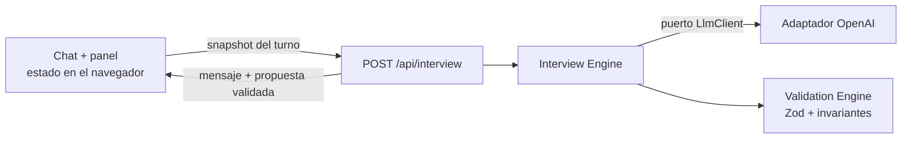

# Trama · Chat de entrada

Chat web que conduce una entrevista guiada y convierte una necesidad de negocio en un requerimiento de datos tipado (`RequerimientoMotor`) para el motor de inferencia de Trama. El usuario revisa el requerimiento en un panel al lado del chat y lo confirma o pide ajustes por el chat. Cada ajuste genera una versión nueva.

> **Estado:** el diseño está completo y la implementación avanza según [PLAN.md](PLAN.md). Las secciones marcadas como *pendiente* se completan en la fase que se indica.

| | |
|---|---|
| Despliegue | *Pendiente (F10).* El código de acceso se comparte por el canal de entrega; no figura en este repo. |
| Video del flujo | *Pendiente (F11).* |
| Transcripciones de tres dominios | *Pendiente (F11).* Van a estar en [docs/transcripts](docs/transcripts). |

## Documentación

| Documento | Contenido |
|---|---|
| [DESIGN.md](DESIGN.md) | Diseño de la entrevista: fases, transiciones, y cuándo el agente pregunta, propone y se detiene |
| [docs/ARCHITECTURE.md](docs/ARCHITECTURE.md) | Módulos, contrato `RequerimientoMotor`, contrato HTTP, flujos de estado, system prompt y salvaguardas |
| [docs/adr](docs/adr/README.md) | Ocho decisiones de arquitectura, con las alternativas descartadas |
| [PLAN.md](PLAN.md) | Fases de implementación, dependencias y criterios de aceptación |
| [docs/enunciado.md](docs/enunciado.md) | Extracto del enunciado del reto: tokens de estilo, contrato base, reglas y criterios de evaluación |

## Cómo funciona

**Principio:** el LLM conversa y propone; el código decide. Todo lo que se puede verificar de forma determinista lo decide código testeable: la forma del requerimiento, las referencias, la justificación de cada dato, la cobertura de las reglas, la completitud y la fase de la entrevista.

1. El agente delimita la necesidad con cuatro ejes: decisión, entidades, período y sospecha. Hace como máximo dos preguntas por turno.
2. A más tardar con el tercer mensaje del usuario, llama a la tool `registrar_requerimiento` y propone un esquema (clases y relaciones), reglas candidatas y las fuentes y columnas mínimas.
3. El servidor valida la propuesta en tres capas: el modo estricto del proveedor, Zod y las invariantes semánticas. Después decide la completitud: para que un requerimiento sea suficiente, cada regla tiene que tener columnas para todo lo que usa. Si la propuesta no valida, no se muestra y el agente pide lo que falta.
4. El panel muestra la versión y su estado. El usuario la confirma o pide ajustes por el chat.



## Stack

Next.js (App Router) · TypeScript · Tailwind v4 · shadcn/ui (`radix-nova`, `neutral`) · Geist · Zod 4 · OpenAI, detrás de un puerto propio · Upstash Redis para el rate limiting · Vitest · Playwright · Vercel.

## Desarrollo local

Requisitos: Node.js 24 (fijado en `.nvmrc`) y pnpm.

```bash
pnpm install
cp .env.example .env.local
pnpm dev
```

En `.env.local` hay que completar, como mínimo, el acceso. Sin estas dos variables la API responde 503, en cualquier entorno:

- `ACCESS_CODE`: 8 caracteres o más;
- `SESSION_SECRET`: 32 bytes o más, por ejemplo con `openssl rand -base64 48`.

Para trabajar sin key de OpenAI, definí `LLM_PROVIDER=fake` y `FAKE_LLM_SCENARIO=e2e`, y la API usa el cliente simulado con el guion del e2e (los escenarios están en `tests/fixtures/scenarios`). Ese guion responde a cuatro mensajes, en este orden:

1. "Aumentaron los reclamos de clientes y no sé por qué."
2. "Quiero decidir si refuerzo el soporte telefónico o el chat. Empezó en marzo de 2026." (v1, faltan datos)
3. "Tenemos una exportación del CRM con canal, fecha y motivo de cada reclamo, y un Excel con los turnos del equipo de soporte." (v2, suficiente)
4. Con *Ajustar*: "Sumá también el email como canal." (v3)

Cualquier otro mensaje recibe una respuesta genérica, y uno que contenga `falla-una-vez` falla por timeout la primera vez, para probar *Reintentar*. Con `LLM_PROVIDER=openai` hacen falta `OPENAI_API_KEY` y `LLM_MODEL`. El modelo elegido es `gpt-5-mini` (ver ADR-0002): admite tool calling estricto (comprobado contra la API) y es de la gama económica; latencia, costo y calidad se calibran en F9. En local el rate limiting usa memoria; Upstash solo es obligatorio en producción. La lista completa de variables está en [ARCHITECTURE.md §11](docs/ARCHITECTURE.md#11-configuración).

La key de OpenAI va solo en `.env.local` y en las variables de entorno de Vercel. Nunca lleva el prefijo `NEXT_PUBLIC_`, nunca se commitea y nunca se escribe en la documentación.

| Script | Qué hace |
|---|---|
| `pnpm dev` | Servidor de desarrollo |
| `pnpm test` | Tests unitarios y de integración, sin red (`pnpm test:coverage` agrega la cobertura) |
| `pnpm test:e2e` | Playwright contra el build, con el LLM simulado y axe en claro y oscuro. Hace el build antes; la primera vez, `pnpm exec playwright install chromium` |
| `pnpm scan:bundle` | Busca secretos en `.next/static` después del build |
| `pnpm eval` | Evaluaciones de la entrevista con el modelo real, requiere la key *(desde F9)* |
| `pnpm typecheck`, `pnpm lint`, `pnpm build` | Las verificaciones que corre la CI |
| `pnpm format` | Formatea el código con Prettier |

## Decisiones y alternativas descartadas

| Decisión | Alternativa descartada | Por qué | ADR |
|---|---|---|---|
| Puerto `LlmClient` propio, con un adaptador para OpenAI | Vercel AI SDK, o llamar al SDK directamente desde la entrevista | La frontera con el proveedor es parte de lo que se evalúa. El AI SDK la oculta e impone su propio modelo de estado. | [0002](docs/adr/0002-abstraccion-del-proveedor-llm.md) |
| Tool `registrar_requerimiento` en modo estricto | Structured Outputs con un sobre `{ mensaje, requerimiento }` en cada turno | El sobre obligaría a emitir JSON también en los turnos que solo preguntan. La tool separa la conversación del artefacto. | [0002](docs/adr/0002-abstraccion-del-proveedor-llm.md) |
| Validación en tres capas, con la completitud decidida por el sistema | Confiar solo en el modo estricto | El modo estricto garantiza la forma, pero no las referencias ni la cobertura de las reglas. | [0004](docs/adr/0004-validacion-y-reintentos.md) |
| Contrato extendido (justificación por columna, `usa` en las reglas, `null` para lo desconocido), con conversión a la forma base | Contrato base sin cambios | La forma base no permite verificar que cada columna esté justificada ni que cada regla tenga sus datos. | [0006](docs/adr/0006-extensiones-del-contrato.md) |
| La fase se deriva del estado y el LLM decide dentro de cada fase | Que el modelo elija la fase, o una máquina de slots con una segunda tool | Es reproducible y testeable. La propuesta forzada en el tercer mensaje evita entrevistas interminables. | [0007](docs/adr/0007-control-de-fases.md) |
| Sesión en el navegador y servidor sin estado; el requerimiento vigente viaja como contexto | Sesión en Redis, o reenviar el historial de tool calls | El servidor no guarda datos del usuario y el historial no depende del proveedor. | [0003](docs/adr/0003-estado-y-flujo-de-datos.md) |
| Route Handler con respuesta JSON, sin streaming en v1 | Server Actions, o streaming desde el principio | La propuesta solo se muestra después de validarse. Si una reparación falla, habría que retractar texto ya transmitido. | [0003](docs/adr/0003-estado-y-flujo-de-datos.md) |
| Código de acceso y rate limiting en Redis por sesión, IP y global | Solo rate limiting, o límites en memoria | Es la forma de proteger de verdad el tope de gasto de la key en un entorno serverless. | [0005](docs/adr/0005-proteccion-contra-abuso.md) |
| Tests sin red, con un fake programable y una suite de contrato para el puerto | MSW, grabaciones tipo VCR o evaluaciones en la CI | Son deterministas y rápidos, y la CI no necesita la key. | [0008](docs/adr/0008-estrategia-de-tests.md) |

## Próximos pasos: del requerimiento confirmado a la carga de datos y el motor

Todo esto queda fuera del alcance del reto. Es lo que haría a continuación:

1. **Manifiesto de carga.** Convertir el requerimiento confirmado en un manifiesto con una ranura de carga por fuente, con su tipo y sus columnas mínimas. Al subir un archivo, se validan los encabezados y los tipos contra el manifiesto antes de aceptarlo.
2. **Mapeo a la ontología.** Cada clase pasa a ser una clase de la ontología, y cada relación una propiedad, con dominio y rango tomados de `sujeto` y `objeto`. Como la justificación de cada columna ya indica qué clase o predicado alimenta, sirve como borrador del mapeo de columnas al grafo (al estilo de RML). Falta definir qué columna identifica a cada instancia.
3. **Formalización de las reglas.** Las reglas candidatas están en lenguaje natural. Hace falta un paso que las traduzca al lenguaje del motor, con revisión humana, y que resuelva los umbrales que quedaron como supuestos en `preguntas_abiertas`.
4. **Calidad de datos antes de razonar.** Detectar claves que no cruzan entre fuentes, fechas fuera del período y valores vacíos en las columnas que alimentan reglas, y reportarlo con el vocabulario del usuario.
5. **Volver a la entrevista cuando los datos no alcanzan.** Si una columna pedida no existe en el archivo real, reabrir el requerimiento con ese hecho como contexto, para que el agente proponga una versión nueva.

## Limitaciones conocidas

**Por diseño:**

- **La cobertura es estructural.** Comprueba que haya una columna para cada elemento, pero no que esa columna contenga lo que se necesita. Eso recién se puede verificar con los datos.
- **La guarda de cifras es heurística.** Bloquea porcentajes y montos que el usuario no aportó, pero no detecta cifras escritas con palabras. La complementan la regla del prompt y las evaluaciones.
- **Los umbrales de fase son heurísticos.** Los valores actuales (3 mensajes y 3 turnos) se calibran con las evaluaciones.
- **La sesión vive en el navegador,** así que no hay continuidad entre dispositivos.
- **Los turnos que proponen tardan más.** Hacen al menos dos llamadas al modelo y, sin streaming, la espera se nota.

**Dónde la entrevista todavía falla:** *pendiente (F9 y F11).* Se completa con lo que muestren las evaluaciones y las transcripciones.

## Uso de IA y colaboración

El diseño (los ADR, la arquitectura, DESIGN.md y PLAN.md) se redactó con asistencia de Claude (Anthropic).

*Completar antes de entregar: quién implementó cada parte y cómo se usó la IA en el código.*

## Estructura del repositorio

```text
├── DESIGN.md          # diseño de la entrevista
├── PLAN.md            # plan de implementación
├── docs/
│   ├── ARCHITECTURE.md
│   ├── adr/           # decisiones de arquitectura
│   └── transcripts/   # transcripciones y requerimientos de los tres dominios
├── src/
│   ├── app/           # rutas de Next.js y Route Handlers
│   ├── domain/        # contrato, validación, sesión y fases (TypeScript puro)
│   ├── contracts/     # DTO HTTP compartidos
│   ├── server/        # entrevista, puerto LLM, seguridad y configuración (solo servidor)
│   └── features/      # UI: workspace, chat, panel y acceso
└── tests/             # unitarios, integración, contrato, e2e y evaluaciones
```
